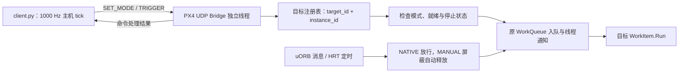

# Manual Trigger、UDP Trigger Bridge 与外部周期调度器

AGENTS.md：依据当前源码实现整理。已做静态分析、客户端离线调度计算与 dry-run，尚未编译 PX4、连接 PX4 运行或进行板端验证。日期：2026-10-27。

本文覆盖三个部分：WorkItem 的 Manual Trigger 设计、PX4 `trigger_bridge` 模块的启动与 UDP 协议、`Tools/trigger_bridge/client.py` 的自动调度与诊断用法。除特别说明，客户端命令均从 `Code/PX4-Autopilot` 仓库根目录运行。

## 设计与调用路径

Manual Trigger 控制一次 WorkItem 的释放，任务计算继续由原 WorkQueue 执行。UDP Bridge 不直接调用模块 `Run()`，也不为每个目标新建线程。



| 组成 | 实现位置 | 职责 |
| --- | --- | --- |
| 模式、注册与生命周期 | `platforms/common/px4_work_queue/ManualTrigger.cpp` | 注册目标实例、处理模式与手动释放、关闭外部访问 |
| 自动释放门控 | WorkItem / ScheduledWorkItem | 覆盖 ScheduleNow、ScheduleDelayed、ScheduleOnInterval、ScheduleAt |
| 执行状态记录 | WorkQueue | 出队时标记运行，Run 返回后用独立 ticket 更新状态，避免访问已自销毁对象 |
| 网络模块 | [TriggerBridge.cpp](TriggerBridge.cpp) | 接收、解析、分派 UDP 命令并返回确认 |
| 协议字段 | [Protocol.hpp](Protocol.hpp) | 固定包长、字节序、命令及回复格式 |
| 外部调度 | [client.py](../../../Tools/trigger_bridge/client.py) | 自动接管、固定周期和顺序发送、异步确认与退出恢复 |

功能由 `CONFIG_MODULES_TRIGGER_BRIDGE` 控制，依赖 `PLATFORM_POSIX`。关闭功能时保留原 WorkItem、WorkQueue 与定时执行路径。启用功能后保持原平台、执行队列、算法及仿真路径，增加模式门控和状态维护。

## 范围与行为

Bridge 只控制下表中的 13 类 WorkItem。默认 NATIVE，通过 UDP 切换指定实例的模式；对象销毁后重新创建也从 NATIVE 开始。land_detector、flight_mode_manager 不注册，不接受控制。

- NATIVE：保留消息与定时释放，TRIGGER 返回 WRONG_MODE。
- MANUAL：普通 ScheduleNow 和定时调度不再释放计算作业，合法 TRIGGER 调用一次 ScheduleNow 等价的入队路径。
- 数据订阅、回调注册和算法输入检查保留，MANUAL 只截断回调到执行队列的路径，不冻结 uORB 数据。
- 每个收到的命令独立处理；没有去重缓存、重传、额外作业队列、LIST 或 GET_STATUS。
- 同一个已排队 WorkItem 不重复排队；执行期间可再次排入一次。ACCEPTED 不承诺独立运行次数或有效输出。
- 改变模式成功时清除此前的待执行项、取消自动定时。实际改变模式时若正在运行，返回 BUSY，模式不变；同模式命令幂等返回 OK。
- 构造完成注册后，至少完成一次 NATIVE Run 才允许控制，否则 NOT_READY。就绪仅表示对象完成过运行，不表示估计器已收敛或产生有效输出。
- 返回 NATIVE 恢复最新的定时调度意图，并额外触发一次原生 Run，以恢复各模块的备用调度。
- 停止路径可以越过 MANUAL 门控完成退出，不执行网络命令中的任意函数。
- Bridge 的启动、停止、重启不改变现存对象的模式；停止前可逐个恢复 NATIVE。

同一队列中的 WorkItem 仍由该队列串行调用。操作系统唤醒的是 WorkQueue 线程，TRIGGER 指定的是逻辑 WorkItem；两者不是一一对应的独立线程。

模式切换与队列出队通过同一控制锁协调。改变模式时若目标仍在执行，返回 BUSY；切换成功后才返回 OK。同模式请求直接返回 OK，不清空该模式下已有的待执行请求。注销时先关闭外部访问，再等待在途运行和已取出的定时回调结束；停止请求使用独立通路越过 MANUAL 门控。详细代码审查见 [CodeReview.md](CodeReview.md)。

## 构建与启动

已在 Firefly、OrangePi 的 RK3588S 默认 board 配置启用：

```text
CONFIG_MODULES_TRIGGER_BRIDGE=y
```

原有 EKF2 编译能力、board 平台选择、启动脚本及仿真模式均保留。需要本实验的单实例 EKF2 时，在 sensors / EKF2 启动前自行配置以下参数；不由 Bridge 隐式改写：

```sh
param set EKF2_MULTI_IMU 0
param set SENS_IMU_MODE 1
```

Bridge 当前仅注册 EKF2 的单实例 0；原有多实例模式继续按 PX4 原生逻辑运行，不注册为手动目标。

PX4 控制台启动（不自动加入所有启动脚本）：

```sh
trigger_bridge start
# 默认 127.0.0.1:19000；可显式指定 IPv4 地址与端口
trigger_bridge start -a 127.0.0.1 -p 19000
trigger_bridge status
trigger_bridge stop
```

模块参数：

| 参数 | 默认值 | 含义 |
| --- | --- | --- |
| `-a` | `127.0.0.1` | 绑定的本机 IPv4 地址 |
| `-p` | `19000` | UDP 端口，范围 1–65535 |

本机调度器可直接使用默认地址。若调度器运行在 LAN 中另一台设备上，PX4 端监听所有 IPv4 接口，或显式绑定 RK3588 的 LAN 地址：

```sh
trigger_bridge start -a 0.0.0.0 -p 19000
# 或绑定指定接口地址；二选一，不要重复启动
trigger_bridge start -a 192.168.1.5 -p 19000
```

`0.0.0.0` 是服务端监听地址；客户端 `--host` 使用 RK3588 的实际 IP。回复发送到收到命令的源 IP 和源端口。

也可以像其他 PX4 模块一样，在**实际选用的** `.config` 启动脚本中加入，例如放在目标模块启动之后：

```sh
mc_pos_control start
mc_att_control start
mc_rate_control start

trigger_bridge start -a 0.0.0.0 -p 19000
```

`.px4board` 中的选项决定是否编译；`.config` 中的命令决定是否启动接收线程。当前实现未自动向已有 Real/HITL 启动脚本插入上述命令；应选择控制台启动或脚本启动其中一种方式。Bridge 启动后各目标仍保持 NATIVE，直到收到模式切换命令。

| 运行场景 | 使用范围 |
| --- | --- |
| RK3588 Real | 可控制实际启动并注册的目标；默认调度表为 12 类，不含 pwm_out_sim。pca9685_pwm_out 保持原生运行 |
| RK3588 HITL | 可控制实际启动并注册的目标；默认表额外包含 pwm_out_sim，共 13 类。保留 sensors / pwm_out_sim 的 HIL 启动选项 |
| POSIX SITL / SIH 等 | 不改原启动及仿真结构；需在相应构建显式启用 Bridge。当前没有专用 SITL/SIH 频率配置表，不应将 HITL 表当作已经验证的通用仿真表 |

`status` 是 PX4 本地模块命令，仅显示绑定地址，不是 UDP 状态查询。一个端口仅允许一个 Bridge 绑定，不设置 SO_REUSEADDR。

模块依赖 PLATFORM_POSIX，目标使用环境为 POSIX/Linux。公共调度钩子、注册表和 HRT 同步辅助均由 CONFIG_MODULES_TRIGGER_BRIDGE 控制；关闭该功能时使用原来的 WorkItem、WorkQueue 和定时执行路径。没有 NuttX 后端或平台选择改动。

SITL、HITL、SIH、replay 与 lockstep 的原有配置、启动脚本和调用路径保持。需要在 POSIX SITL 构建中使用 Bridge 时，显式启用 CONFIG_MODULES_TRIGGER_BRIDGE 即可，不需要额外设置 BOARD_LINUX_TARGET。保留仿真路径不代表手动释放在这些模式下已经验证，尤其 lockstep 中的时间推进仍需后续运行核验。

## 请求与回复

固定 24 字节，每个 UDP 数据报一条命令。多字节整数均为大端；按字段编码，不使用 C++ struct 的内存布局。

| 偏移 | 字节 | 请求字段 | 约定 |
| --- | --- | --- | --- |
| 0 | 4 | magic | 0x50585452，即 ASCII PXTR |
| 4 | 1 | version | 1 |
| 5 | 1 | opcode | 1=SET_MODE，2=TRIGGER |
| 6 | 1 | mode | SET_MODE：0=NATIVE、1=MANUAL；TRIGGER：必须 0 |
| 7 | 1 | reserved | 必须 0 |
| 8 | 8 | request_id | 仅用于匹配回复，无去重意义 |
| 16 | 4 | target_id | 下表固定编号 |
| 20 | 2 | instance_id | 通常为 0；VehicleIMU 按构造时的实例编号 |
| 22 | 2 | reserved | 必须 0 |

回复同为 24 字节，opcode 为请求 opcode OR 0x80，偏移 6 改为 result；回显 request_id、target_id、instance_id，版本为 1，保留字段清零。

| result | 名称 | 含义 |
| --- | --- | --- |
| 0 | OK | 模式已设置或原本就是该模式 |
| 1 | ACCEPTED | 已调用原 WorkQueue 入队路径，可能被原队列合并 |
| 2 | UNKNOWN_TARGET | 目标实例未注册或已销毁 |
| 3 | WRONG_MODE | NATIVE 下收到 TRIGGER |
| 4 | BUSY | 目标正在运行，未提交模式切换；可由操作者稍后另发命令 |
| 5 | NOT_READY | 尚未完成首次运行或尚未附着有效队列 |
| 6 | STOPPING | 目标正在停止，不接受控制 |
| 7 | BAD_PACKET | 版本或保留字段非法 |
| 8 | BAD_COMMAND | opcode 或 mode 非法 |

长度不为 24、magic 错误、收到回复包时直接丢弃，不触发任务。请求乱序按实际接收顺序处理；重复数据报按新命令处理。丢包或回复丢失时，不保证交付或判定执行结果，也不自动重发。诊断/模式命令超时退出，自动调度期间的触发确认超时仅记统计并继续运行。协议不提供跨对象重建的命令代次保护，因此不要向重启的模块重放旧数据报。

## 静态目标编号

| 名称 | target_id | instance_id |
| --- | --- | --- |
| vehicle_imu | 0x11111240 | 实际 IMU 实例 |
| vehicle_angular_velocity | 0x11111250 | 0 |
| vehicle_acceleration | 0x11111260 | 0 |
| vehicle_magnetometer | 0x11111270 | 0 |
| vehicle_air_data | 0x11111280 | 0 |
| sensors | 0x11111290 | 0 |
| ekf2 | 0x11111300 | 0 |
| mc_hover_thrust_estimator | 0x11111310 | 0 |
| mc_rate_control | 0x11111330 | 0 |
| mc_att_control | 0x11111340 | 0 |
| mc_pos_control | 0x11111350 | 0 |
| control_allocator | 0x11111370 | 0 |
| pwm_out_sim | 0x11111380 | 0 |

目标 ID 沿用开始 Marker 的数值，不根据 ID 发送 SYS_kill；原目标 Marker 继续保留。模块未启动或该构建未包含它时返回 UNKNOWN_TARGET。

## client.py：自动周期调度器

客户端使用 Python 标准库，无额外依赖。常规实验使用 `schedule`，一次命令自动接管整张任务表。`mode`、`trigger` 保留用于单目标诊断。

以下客户端示例均在 PX4 仓库根目录运行，先按 AGENTS.md 设置解释器路径：

```sh
TRIGGER_PYTHON=/home/leeziy/Software/ProgramFiles/Conda/envs/onnx/bin/python
```

将工具目录复制到其他主机时，保留 `client.py` 和 `schedules.json` 的相对位置，并把解释器路径改为该主机的 Python。

### 常用命令

```sh
# 离线查看任务、频率、顺序及相位，不创建 UDP Socket
"$TRIGGER_PYTHON" Tools/trigger_bridge/client.py schedule --profile hitl --dry-run

# 本机 Real，持续运行，Ctrl-C 结束
"$TRIGGER_PYTHON" Tools/trigger_bridge/client.py schedule --profile real

# LAN HITL，运行 30 秒并保存最终统计
"$TRIGGER_PYTHON" Tools/trigger_bridge/client.py --host 192.168.1.5 --port 19000 \
  schedule --profile hitl --duration 30 --summary run.json

# 排除未启用的磁力计目标，并覆盖气压处理请求率
"$TRIGGER_PYTHON" Tools/trigger_bridge/client.py --host 192.168.1.5 \
  schedule --profile hitl --exclude vehicle_magnetometer --rate vehicle_air_data=50

# 使用自定义任务表
"$TRIGGER_PYTHON" Tools/trigger_bridge/client.py \
  schedule --profile hitl --config my_schedule.json --duration 10
```

调度前应确认 Bridge 已启动、相应目标已启动并完成首次 NATIVE Run，且 EKF2 使用单实例。某目标未启动时，按实际配置使用 `--exclude`，或从自定义任务表中移除；调度器不会自动忽略 UNKNOWN_TARGET。

### 命令行参数

通用网络参数放在子命令 **之前**：

| 参数 | 默认值 | 作用 |
| --- | --- | --- |
| `--host` | `127.0.0.1` | PX4 接收端地址；LAN 使用 RK3588 实际 IP |
| `--port` | `19000` | UDP 目标端口 |
| `--timeout` | `1.0` 秒 | 模式命令回复等待时间；周期阶段也用作触发确认超时阈值 |

`schedule` 参数放在子命令 **之后**：

| 参数 | 默认值 | 作用 |
| --- | --- | --- |
| `--profile real\|hitl` | 必填 | 选择 JSON 中的调度表 |
| `--config PATH` | 脚本同目录 `schedules.json` | 自定义配置文件，路径不依赖当前工作目录查找默认表 |
| `--duration SECONDS` | `0` | 大于 0 时限定逻辑调度时间；0 表示持续运行 |
| `--exclude TARGET` | 无 | 按名称排除目标，可重复使用；该目标所有配置实例均排除 |
| `--rate TARGET=HZ` | 无 | 按名称覆盖请求率，可重复使用；不改 PX4 内部参数 |
| `--setup-timeout SECONDS` | `5.0` | 每个目标、每次模式转换等待 BUSY/NOT_READY 消退的最长时间 |
| `--report-interval SECONDS` | `1.0` | 控制台汇总输出间隔 |
| `--summary PATH` | 无 | 保存最终 JSON 统计 |
| `--dry-run` | 关闭 | 加载并打印配置后退出，不连接 PX4 |

### 默认频率和发送顺序

默认配置见 [schedules.json](../../../Tools/trigger_bridge/schedules.json)。以下数字对应当前 `schedules.json`，是**调度器请求频率，不是原生实际 Run 率的测量值**。最初依据参考分支 `ROC-RK3588S-PC` commit `2f629949b0` 分析，当前表已调整为下列实验配置；原始参数分析见 [NativeRates.md](../../../Tools/trigger_bridge/NativeRates.md)，其中历史初始表不替代当前 JSON。Real 的 FIFO 批次、HITL 输入流以及已保存参数均可能改变实际频率。

| 同 tick 次序 | 目标 | Real 请求 Hz | HITL 请求 Hz |
| --- | --- | --- | --- |
| 1 | vehicle_magnetometer | 20 | 20 |
| 2 | vehicle_air_data | 30 | 30 |
| 3 | vehicle_imu | 400 | 400 |
| 4 | vehicle_acceleration | 400 | 400 |
| 5 | vehicle_angular_velocity | 400 | 400 |
| 6 | sensors | 400 | 400 |
| 7 | ekf2 | 400 | 400 |
| 8 | mc_pos_control | 100 | 100 |
| 9 | mc_hover_thrust_estimator | 100 | 100 |
| 10 | mc_att_control | 200 | 200 |
| 11 | mc_rate_control | 400 | 400 |
| 12 | control_allocator | 400 | 400 |
| 13 | pwm_out_sim | 不启用 | 400 |

HITL 的磁场与气压输入率未被参考脚本固定，表中 20/30 Hz 是初始选择，需按实际输入修订。IMU 积分率与 EKF 预测率也不直接等于 WorkItem 运行率；不要用备用定时周期反推正常频率。

### 1000 Hz tick 与自动接管流程

1. 校验配置，按表中顺序向各目标发送 SET_MODE MANUAL，等待 OK。只有收到明确 BUSY/NOT_READY 才在 setup-timeout 内另发新请求；丢失回复不重传原包。
2. 全部接管成功后，使用主机单调时钟的绝对时间 `epoch + tick × 1 ms` 驱动循环。
3. 每个 tick 按 tasks 数组顺序发送到期目标的 TRIGGER，不逐包等待确认，使用非阻塞接收匹配异步回复。
4. 正常结束、Ctrl-C、SIGTERM 或处理到的异常时，按逆序尝试恢复所有曾尝试接管的目标为 NATIVE，并报告恢复失败项。

对于频率 f、相位 p，第 k 次逻辑释放映射到 tick `p + ceil(k × 1000/f)`。200 Hz 每 5 tick 一次；400 Hz 在 tick 0、3、5、8、10……释放，间隔交替 3/2 ms；30 Hz 在 tick 0、34、67、100……释放。使用有理数运算，避免将频率简单取整。

主机错过 tick 时直接推进到当前 tick，每个目标最多发一次，统计过期释放，不集中补发。主机 1000 Hz tick 不等于硬实时保证，也不等于 PX4 的仿真时钟。SITL/HITL/SIH/replay/lockstep 时间源不被改写；仿真暂停或变速时没有实现时钟同步。

固定顺序仅约束发送请求。UDP 可能乱序，独立 WorkQueue 也可能先执行下游；ACCEPTED 不表示上游已经完成。该调度器提供固定释放基线，不实现完成依赖屏障、CPU Affinity 或 Priority 控制。

### 自定义 JSON 调度表

文件要求 `tick_hz=1000`，通过 `profiles.real` 或 `profiles.hitl` 选择表；tasks 数组位置决定同 tick 的先后顺序。以下是仅接管三个目标的最小 HITL 示例，其余模块继续原生运行：

```json
{
  "tick_hz": 1000,
  "profiles": {
    "hitl": {
      "tasks": [
        {"target": "vehicle_imu", "instance": 0, "rate_hz": 1000, "phase_ticks": 0},
        {"target": "sensors", "instance": 0, "rate_hz": 1000, "phase_ticks": 0},
        {"target": "ekf2", "instance": 0, "rate_hz": 1000, "phase_ticks": 0}
      ]
    }
  }
}
```

| 字段 | 规则 |
| --- | --- |
| `target` | 使用静态目标表中的名称 |
| `instance` | 默认 0，范围 0–65535；同目标不同实例可分项配置，EKF2 只允许 0 |
| `rate_hz` | 必填，大于 0 且不超过 1000；可用数字或有理数字符串，例如 `"1000/3"` |
| `phase_ticks` | 默认 0，非负整数，表示相对调度起点的首次释放偏移 |
| `basis` | 可选，记录频率来源，不参与调度 |

相同 target/instance 不能重复配置。`--rate` 对同名目标的全部配置实例生效；改变请求率不会改变传感器积分、发布限制或控制器参数，输出频率仍由原模块逻辑决定。

### 输出统计与退出行为

周期运行时输出 tick、sent、accepted、pending 和 skipped_ticks。最终控制台打印 JSON；指定 `--summary` 时同时写入文件。

| 字段 | 含义 |
| --- | --- |
| `executed_ticks` / `skipped_ticks` | 实际处理的 tick 数 / 主机延迟跳过的 tick 数 |
| `max_wakeup_lateness_ns` | 相对本轮预定 tick 的最大主机唤醒延迟，纳秒 |
| `dispatch_elapsed_s` | 调度阶段耗时，不含模式恢复阶段 |
| 每目标 `sent` / `accepted` / `rejected` | 成功发送的数据报数 / 收到成功确认数 / 收到拒绝确认数 |
| 每目标 `timed_out` | 到检查超时时仍未收到匹配确认的请求数，不重发 |
| 每目标 `skipped_releases` | 因主机推进到较晚 tick 而跳过的逻辑释放次数 |
| 每目标 `send_failed` | 非阻塞发送暂时无法完成的次数，不重发 |
| `outstanding_replies` | 最终仍待确认且尚未按超时归类的请求数 |
| `restore_errors` | 恢复 NATIVE 失败的目标和原因 |

统计记录 reference commit、配置频率、相位和目标实例；sent/accepted 都不能替代 PX4 轨迹中的 Run 次数或有效输出率。初始化失败、触发被拒绝或恢复失败返回非零退出码；单纯缺失触发 ACK 记统计并继续调度。

客户端不查询接管前模式，退出时统一尝试恢复为 NATIVE。Bridge 自身停止不会恢复目标；强制 kill、主机崩溃、网络中断或再次中断退出清理时，不能保证恢复成功。

## client.py：单目标诊断

```sh
# 模式切换
"$TRIGGER_PYTHON" Tools/trigger_bridge/client.py mode mc_pos_control manual
"$TRIGGER_PYTHON" Tools/trigger_bridge/client.py mode mc_pos_control native

# 单次触发；也支持数值 ID
"$TRIGGER_PYTHON" Tools/trigger_bridge/client.py trigger mc_pos_control
"$TRIGGER_PYTHON" Tools/trigger_bridge/client.py trigger 0x11111350

# 诊断性周期发送，逐条等待回复
"$TRIGGER_PYTHON" Tools/trigger_bridge/client.py trigger mc_pos_control --hz 50 --count 100

# 指定实际 IMU 实例
"$TRIGGER_PYTHON" Tools/trigger_bridge/client.py trigger vehicle_imu --instance 0
```

`mode TARGET native|manual`、`trigger TARGET` 均支持 `--instance`，默认 0。`trigger --count` 默认 1；多次发送需指定正的 `--hz`。诊断命令每条发送一次并等待匹配回复，错误或超时退出，不自动重传，也不自动恢复模式。其 `--hz` 是尽力实现的发送频率，不是上述异步 1000 Hz 调度器。

## 复核入口与验证状态

模式、协议、生命周期和构建路径的静态审查见 [CodeReview.md](CodeReview.md)；参考分支频率依据见 [NativeRates.md](../../../Tools/trigger_bridge/NativeRates.md)。已完成客户端离线周期计算、配置校验和回复解析检查，尚未编译 PX4、测量原生实际频率或验证 Real/HITL/LAN 运行表现。
